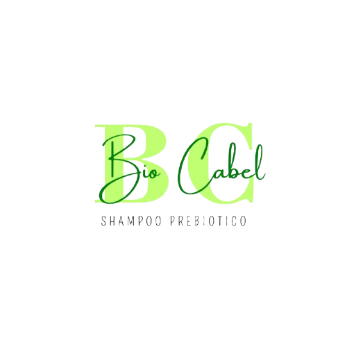

# 🌿 BioCabel - Landing Page

Página web de producto de champú prebiótico BioCabel

## 📁 Estructura del Proyecto

```
Proyect biocamel/
├── index.html              # Página principal
├── assets/
│   ├── img/               # 📷 Imágenes (logo, producto, ingredientes)
│   │   └── README.md      # Instrucciones para agregar imágenes
│   └── fonts/             # 🔤 Fuentes personalizadas
├── css/
│   └── style.css          # 🎨 Estilos principales
├── js/
│   └── script.js          # ⚙️ Interactividad
└── README.md              # Este archivo
```

## 🎯 Características

✅ Navegación responsive  
✅ Sección hero con CTA  
✅ Problemas y soluciones  
✅ Beneficios del producto  
✅ Ingredientes naturales   
✅ FAQ  
✅ Formulario de contacto  
✅ Botón flotante de WhatsApp  
✅ Animaciones suaves  

## 🚀 Cómo Usar

1. **Agregar imágenes**
   - Ve a `assets/img/`
   - Lee el archivo `README.md` para saber qué imágenes necesitas
   - Coloca tus imágenes en esa carpeta

2. **Personalizar estilos**
   - Edita `css/style.css`
   - Modifica colores, fuentes, espacios, etc.

3. **Agregar interactividad**
   - Edita `js/script.js`
   - Añade nuevas funciones según necesites

4. **Actualizar contenido**
   - Edita `index.html`
   - Cambia textos, descripción de productos, etc.

## 🔌 Recursos Usados

- **Bootstrap 5.3.7** - Framework CSS
- **Bootstrap Icons** - Iconos
- **Google Fonts** - Tipografía (Poppins, Cormorant Garamond)


---

**Última actualización:** 24 de Julio de 2026
